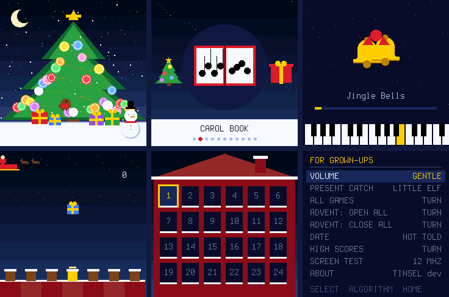

# Tinsel

**Christmas music toys and games for the M-VAVE FM-1, all in one firmware, for every age.**

<p align="center"></p>

Switch it on and you are in the **Grotto**: a Christmas tree with a bauble above every key. Press a key and its
bell rings and its bauble lights; press them all and the sleigh bells go. Turn any knob and a robin flies about,
and whatever it lands on does something (the presents pop, the snowman's hat hops, the star sparkles). PLAY is the
big moment: a fanfare and a snowstorm. Nothing in the Grotto can go wrong, and nothing in it changes a setting.

**HOME** goes back to the Grotto from anywhere. In the Grotto, HOME (the little sleigh in the corner) opens **the
Sleigh**, a menu of big pictures: turn any knob to choose, then PLAY (or any key, or any button) to go in.

| | |
| --- | --- |
| **The Carol Book** | Eight carols, three ways. *Magic*: any key plays the next note, so a toddler bashing the keys plays Jingle Bells. *Follow*: the next key lights up and the band waits for you. *Listen*: it plays itself. |
| **Present Catch** | Presents fall towards seven chimneys; the keys under the lowest one light up. Every catch plays the next note of Jingle Bells. At *Little Elf* (the default) nothing is ever missed. |
| **The Advent calendar** | A house with 24 windows; the first 24 keys are the doors. Each door holds a carol, a joke, a sound or a new decoration for the Grotto. It learns the date from [web/advent.html](web/advent.html) (Chrome or Edge, over USB), or counts the days it is switched on. |
| **The Music Box** | Crank it with any knob, or wind it up with PLAY. Four carol boxes, and one of your own: press keys to put pins in. |
| **The Bell Tower** | Six church bells. Ring them on the keys; ring rounds and make call changes; or ring Plain Bob and Grandsire, taking one bell yourself. |
| **The Snow Globe** | Turn the knobs to shake it; the snow swirls, tiny bells follow it, and it settles into a chord. |
| **Jingle It!** | "Ring it! Twist it! Jingle it!": a call, a picture and a sound, and you do it. |
| **Cracker Pull** | Two players, low keys against high keys (or you against an elf), pulling on the beat until it goes BANG. A hat, and a joke. |
| **Snowball Rally** | A rooftop rally for two, a knob each; an elf takes an empty end. Every return plays the next note of a carol. |
| **Sleigh Ride** | Steer the sleigh and ring the bell posts as they pass. |

A brightly lit key means *press me*; a glowing one means *next*. Holding **EDIT** shows what this screen's controls
do. Holding **EDIT and SAVE together for two seconds**
opens the grown-up panel: the volume ceiling (gentle by default, for small ears), the games' levels (Little Elf, Elf,
Santa), the calendar, the date, the high scores. Nothing a small hand does outside the panel deletes anything.

The grown-ups' guide: **[docs/GUIDE.md](docs/GUIDE.md)**. The design and the research behind it:
[docs/DESIGN.md](docs/DESIGN.md), [docs/RESEARCH-NOTES.md](docs/RESEARCH-NOTES.md).

Unofficial: not made or endorsed by M-VAVE. Installing firmware is at your own risk.

## Installing

Tinsel's package identity is **FM-1_902**. Install `tinsel-X.Y.fwsc` from the releases like any community firmware:
with the [FM-1 Firmware Hub](https://thefirmwarehub.com), M-Flasher's download mode, or
`python3 tools/fm1_install.py tinsel-X.Y.fwsc`. The way back is the same, with another firmware or M-VAVE's own.

Tinsel keeps its settings and the calendar in its own corner of the FM-1's flash (0xB7000..0xDFFFF), so going back
and forth between Tinsel and another Dinghy-based firmware (Melisma, Dinghy itself) leaves the other's saved data
alone.

## Building and checking

Tinsel is built on [Dinghy](https://github.com/zvenson/dinghy): everything in [docs/DINGHY.md](docs/DINGHY.md)
(the toolchain, the SDK, Docker on macOS) applies.

```sh
tools/check.sh            # the carols, the unit tests, a host run through every screen (seconds)
tools/check.sh --full     # then the device build, the platform's tests, the sound's heaviest moment and a boot in fm1-emu
tests/run_host.sh tests/scripts/tinsel.txt   # the screens as PNG and the sound as WAV, in build/host/
./build.sh --release 0.1  # build/tinsel-0.1.fwsc
```

- `firmware/src/tinsel.c` is the app: the screens, the loop, what is kept, the help cards. Each screen is a header
  (`tn_grotto.h`, `tn_sleigh.h`, `tn_carolbook.h`, `tn_catchgame.h`, `tn_adventscr.h`, `tn_musicbox.h`,
  `tn_bells.h`, `tn_globe.h`, `tn_play.h` for Jingle It!, Cracker Pull, Snowball Rally and Sleigh Ride, `tn_panel.h`).
- `tn_snd.h` is the sound: bells, celesta, music box, glockenspiel, sleigh bells, a cathedral reverb, and a
  ceiling the sound never passes.
- `tn_gfx.h` draws a byte a pixel and sends the panel only what changed.
- The rules are pure and tested by `tests/tn_test.c`: the carol player (`tn_carol.h`), the games (`tn_catch.h`,
  `tn_games.h`), the calendar (`tn_advent.h`), change ringing (`tn_ring.h`: Plain Bob and Grandsire checked against
  their lead heads and extents), the music box's cylinder (`tn_box.h`).
- The carols are our own transcriptions, one text file each in [music/](music/). `tools/gen_music.py` checks
  every bar and makes `firmware/gen/tn_music.h`. Only public-domain melodies are used; see
  [music/README.md](music/README.md).

## Credits and licence

GPL-3.0-only. Tinsel is by **Joel Merrick**. It stands on [Dinghy](https://github.com/zvenson/dinghy) (zvenson),
which stands on [Felucca](https://github.com/hugelton/Felucca) (Leo Kuroshita, Hügelton Instruments) and
[SLOOP](https://github.com/isod89/sloop-fm1) (isod89). The details, and everyone else whose work or ideas are in
here, are in [LICENSING.md](LICENSING.md).
